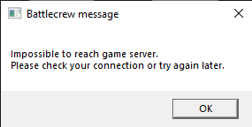

# Battlecrew Space Pirates Revived

This is Slop.

> Battlecrew Space Pirates Revived is a fan project. It is not affiliated with or endorsed by DONTNOD ELEVEN.
> This was tested and made for a steam copy.

A project to get BSP working again. Currently, the game shows the following error when launched from Steam:

If you want to give a thanks: https://ko-fi.com/birden. No perks or help will be given to this, Ko-fi is actually for different non-AI projects i do.

## Getting started

1. Download the release files from [HERE](https://github.com/birdenly/BattlecrewSP-Revived/releases).
2. Place the files next to your game executable (`Battlecrew Space Pirates\WAL\Binaries\Win64\WAL.exe`).
3. Run `Patch_game.exe`. This patches the game executable to work offline/locally and creates a backup of your original file.
4. Run `server.exe`.
5. Run `Start_game.bat` to launch the game. Alternatively, you can add these launch options in Steam:

   `HeSawTeamBSP -backendmode=local`

## How it works

### 1. Startup Error
On startup, the game tries to contact the official server to check its status. Because the server is offline, the game shows an error and closes.

To bypass this, we use two built-in developer arguments:
- `HeSawTeamBSP`: Tells the game to ignore server connection failures.
- `-backendmode=local`: Redirects API requests from the dead domain to `localhost:1337`.

The startup status check in the executable is also patched to return immediately, and `server.exe` runs locally to provide the basic profile and game data the client expects.

### 2. Locked Game Modes
In the hub area, game modes were locked because the game tried to check dead server tables for daily tickets and account ownership.

The executable was patched to always report game modes as available and mark the player account as premium, unlocking all modes.

### 3. Match Hosting
Walking into a launch pod and pressing `E` originally did nothing because it tried to contact dead matchmaking servers to allocate a dedicated server.

The pod interaction was patched to bypass matchmaking and load the selected map directly as a listen server (`?listen`). The player in the pod becomes the host, allowing friends in the squad to travel into the match together. (P2P)

### 4. Menu and Terminal Interactions
The `E` key is shared between launching matches and interacting with menus (such as the hero selection terminal). Without an extra check, pressing `E` at a menu would accidentally launch a match.

The patch checks whether the player is actively inside a launch pod before triggering map travel. Pressing `E` anywhere else lets you interact with terminals, change characters, or manage squads normally.

### 5. Memory Stability (ASLR)
Windows Address Space Layout Randomization (ASLR) shifts the game's base memory address every time it starts. ASLR was disabled in the executable header so memory addresses remain consistent and avoid crashes.

---
